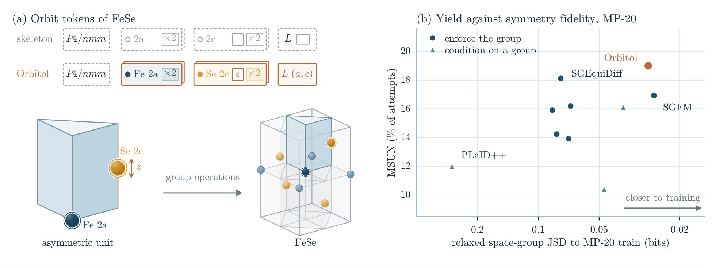

<p align="center">
  <picture>
    <source media="(prefers-color-scheme: dark)" srcset="media/orbitol_logo_dark.svg">
    
  </picture>
</p>

<p align="center">
  <a href="https://arxiv.org/abs/2610.30086"></a>
  <a href="https://huggingface.co/stases/orbitol"></a>
  <a href="LICENSE"></a>
</p>

Orbitol is a diffusion model for crystals with a prescribed space group. Given the space group and the occupied
Wyckoff positions, it generates only what the symmetry leaves free, with one token per orbit and one for the lattice,
and the group operations place every other atom. The network and the EDM sampler are those of
[Crystalite](https://github.com/joshrosie/crystalite). On one RTX 6000 Ada, the released MP-20 model samples about
920 structures per second (25 sampler steps, fast decoder; paper, Table 13).

<p align="center">
  
  <br>
  <em>(a) Orbit tokens of FeSe. (b) Discovery yield (MSUN) on MP-20 against how closely the relaxed space groups match the training data.</em>
</p>

## How it works

Orbitol starts every crystal from a skeleton, which fixes the space group and the Wyckoff positions that are occupied.
A Wyckoff position with free coordinates can hold more than one orbit. For each orbit, the model generates an atom type
and the orbit's free fractional coordinates, and one more token holds the free parameters of the unit cell. In the
FeSe example in panel (a), the skeleton is $`P4/nmm`$ with the positions $`2a`$ and $`2c`$. Fe sits on $`2a`$, which
has no free coordinate, and Se sits on $`2c`$, which has one, its height along $`c`$. Together with the cell
parameters $`a`$ and $`c`$ of the tetragonal cell, two atom types and three numbers describe the whole four-atom cell.

The space-group operations then place every atom of an orbit. If $`u_k`$ are the free coordinates of an orbit on
Wyckoff position $`w`$, its $`m_w`$ atoms sit at

```math
f_{kj} = \mathrm{mod}_1\big(W_{w,j}\,(u_k + \tfrac12) + v_{w,j}\big), \qquad j = 1, \dots, m_w,
```

where the maps $`(W_{w,j}, v_{w,j})`$ follow from the space-group operations. All atoms of an orbit have the same
type, so every valid structure that comes out of the decoder is symmetric under the requested space group. The space
group detected afterwards can be higher, a supergroup of the requested one.

The denoiser is Crystalite's Transformer. It denoises the atom-type encodings, the free coordinates and the lattice
parameters together, conditioned on the space group and on the Wyckoff position of each token. Four things change to
make it work on orbits. The coordinate noise is scaled per Wyckoff position, so that a given noise level moves atoms
equally far on every position. The coordinate head predicts a 3-D update for one representative atom of each orbit
and projects it onto the directions its position allows. Because the free coordinates are periodic, the training
target is the posterior mean over their periodic images. Finally, the distance-based attention biases (GEM) are
combined over the atoms of each orbit, so that an orbit receives the total attention weight of its atoms.

To sample, Orbitol draws a skeleton from the distribution of skeletons in the training set, the EDM sampler denoises
the free variables, and the decoder expands the orbits into a primitive cell. The skeleton prior is separate from the
model, so you can replace it without retraining, for example with one that only uses space groups you choose. In
$`P1`$ every orbit is a single atom and the representation is the same as Crystalite's. With Crystalite's objective,
GEM switched off and the Wyckoff and group embeddings set to zero, Orbitol reproduces Crystalite's denoiser, loss and
sampler exactly.

## Installation

Orbitol needs Linux, an NVIDIA GPU, [uv](https://docs.astral.sh/uv/), git, and a CUDA toolkit with gcc ≥ 12 for the
relaxer's kernels.

```bash
git clone https://github.com/stases/orbitol && cd orbitol
tools/setup_env.sh                                # locked environment and the pinned Crystalite core
cp orbitol.local.env.example orbitol.local.env    # then set ORBITOL_DATA_HOME and ORBITOL_RUNS_ROOT
```

`tools/setup_env.sh` prints the exports to apply before running Orbitol. [docs/hardware.md](docs/hardware.md) covers
GPUs without bf16.

## Quick start

Download the released MP-20 model, its data and the NequIP relaxer from Hugging Face:

```bash
BUNDLE=https://huggingface.co/stases/orbitol/resolve/0df0e17ce04a39ab78fb6c3a74dcce4a05495a6c
python -m tools.release.fetch --bundle "$BUNDLE" --public mp20-raw,mp20-hull
CKPT="$(python -m orbitol.contracts ORBITOL_DATA_HOME)/checkpoints/mp20_x_postper_2500k/step_1500000.pt"
```

Sample 1,000 crystals with the paper's 25-step sampler and write them as CIF files:

```bash
python -m orbitol.sample "$CKPT" --n 1000 --out samples.pt --cif-dir cifs \
    --sample-num-steps 25 --S-churn 10 --sigma-min 0.01 --sigma-max 3
```

Sample, relax with NequIP and score stability, uniqueness and novelty against MP-20:

```bash
python -m orbitol.posthoc_eval --kind orbitol --snapshot "$CKPT" --out runs/demo --sample-count 1000 \
    --sampler-overrides "$(cat configs/paper/sampler_mp20_fast.json)"
```

The metrics, including MSUN, are written to `runs/demo/metrics.json`.
[docs/constrained_sampling.md](docs/constrained_sampling.md) shows how to fix elements, coordinates or lattice
parameters during sampling.

## Training

Train the paper's MP-20 model (2.5M steps; the released checkpoint is step 1.5M):

```bash
python -m orbitol.train --run-name mp20 --config configs/paper/mp20_x_postper_2500k.json
```

Every config field is also a command-line flag. [docs/training.md](docs/training.md) lists the flags, the paper's model
variants and the Slurm setup.

## Reproducing the paper

[docs/reproduce.md](docs/reproduce.md) gives the commands and expected results for the MP-20 sample pools, the sampler
sweep (Table 12) and retraining.

## Documentation

- [Training and sampling](docs/training.md): environment, flags, model variants, Slurm, packing
- [Evaluation](docs/evaluation.md): protocol, post-hoc evaluation, evaluation during training, relaxation
- [Metrics](docs/metrics.md): logged names, definitions and denominators
- [Datasets](docs/datasets.md): MP-20 and Alex-MP-20 data, caches and hulls
- [Hardware](docs/hardware.md): throughput per GPU and settings for GPUs without bf16
- [Constrained sampling](docs/constrained_sampling.md): fixed elements, coordinates or lattice parameters
- [Reproducing the paper](docs/reproduce.md)
- [Evaluator details](docs/evaluation_adapter.md), [evaluation jobs](docs/eval_jobs_contract.md) and the
  [Alex-MP hull reference](docs/alex_reference.md)

## Citation

```bibtex
@article{zugec2026orbitol,
  title   = {Orbitol: Crystal Generation on Wyckoff Orbits},
  author  = {{\v{Z}}ugec, Ivan and Rosenthal, Joshua and Lon{\v{c}}ari{\'c}, Ivor and van de Meent, Jan-Willem and
             Had{\v{z}}i Veljkovi{\'c}, Tin},
  journal = {arXiv preprint arXiv:2610.30086},
  year    = {2026}
}
```

## License

Code: [MIT](LICENSE); code derived from pymatgen and Crystalite keeps their notices in
[THIRD_PARTY_NOTICES.md](THIRD_PARTY_NOTICES.md). Release weights and data: CC BY 4.0; see
[licences and source attribution](tools/release/ATTRIBUTION.md).

Logo adapted from the Crystalite logo by [Dee Vasilevskaia](https://deevasilevskaia.com/).
